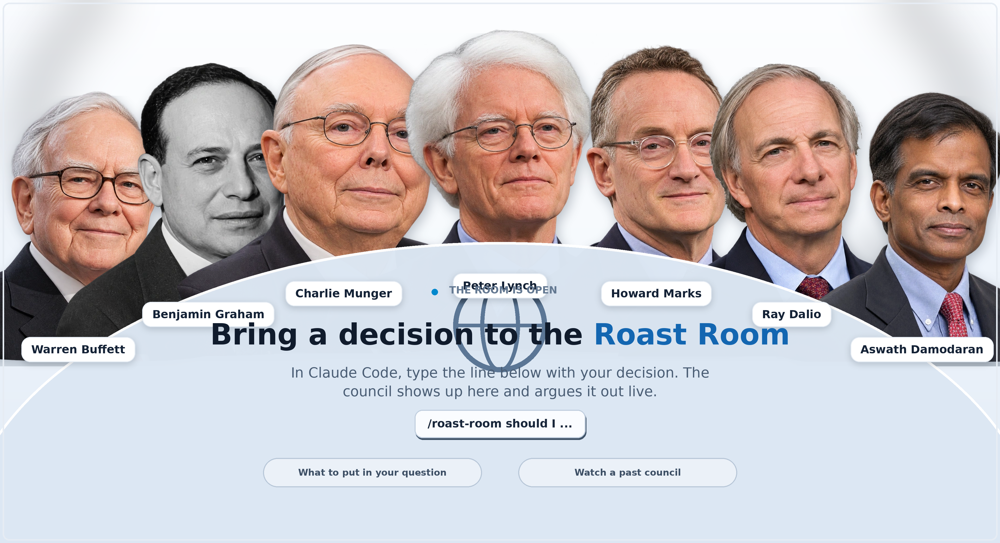

# Finance Roast Room



**An AI-powered investment debate room.** Bring a decision about investing, trading, valuation or capital allocation. A council of simulated finance thinkers tests the assumptions, argues opposing cases and produces a weighted verdict with a downloadable PDF report.

The project combines a local web viewer with a 20-person advisor roster and structured, multi-round deliberation.

## What it does

- **20 finance perspectives** spanning value investing, Indian equities, company valuation, macro, momentum and risk.
- **Decision-specific boards:** choose 4–7 relevant advisors instead of forcing every question through the same panel.
- **Three-round debate:** independent opening views, challenges on the key disagreements, then a vote on the Chair's resolution.
- **Weighted scoring:** advisor scores are weighted by relevance, with downside and ruin-risk checks.
- **Readable verdicts:** recommendation, conditions, next steps, kill criteria and a PDF report.
- **Live visual room:** advisor portraits, debate cards, fault lines, votes and verdicts appear in the browser as session files are written.
- **Past sessions:** the repository includes a few clearly labelled sample councils. New local sessions are ignored by Git by default.

## The 20 advisors

| Advisor | Key | Perspective | Knowledge base |
|---|---|---|---|
| **Warren Buffett** | `buffett` | Long-term value & capital allocation | `.claude/skills/roast-room/brains/warren-buffett/` |
| **Benjamin Graham** | `bgraham` | Security analysis & defensive value | `.claude/skills/roast-room/brains/benjamin-graham/` |
| **Charlie Munger** | `munger` | Multidisciplinary mental models & inversion | `.claude/skills/roast-room/brains/charlie-munger/` |
| **Radhakishan Damani** | `damani` | Indian value & retail economics | `.claude/skills/roast-room/brains/radhakishan-damani/` |
| **Rakesh Jhunjhunwala** | `jhunjhunwala` | Indian growth & market trends | `.claude/skills/roast-room/brains/rakesh-jhunjhunwala/` |
| **Raamdeo Agrawal** | `agrawal` | Quality-growth investing (QGLP) | `.claude/skills/roast-room/brains/raamdeo-agrawal/` |
| **Vijay Kedia** | `kedia` | Small-cap growth & emerging sectors | `.claude/skills/roast-room/brains/vijay-kedia/` |
| **Sanjay Bakshi** | `bakshi` | Behavioural finance & moat architecture | `.claude/skills/roast-room/brains/sanjay-bakshi/` |
| **Parag Parikh** | `parikh` | Behavioural investing & contrarian discipline | `.claude/skills/roast-room/brains/parag-parikh/` |
| **Mohnish Pabrai** | `pabrai` | Concentrated value & Dhandho | `.claude/skills/roast-room/brains/mohnish-pabrai/` |
| **Peter Lynch** | `lynch` | Fundamental growth & PEG valuation | `.claude/skills/roast-room/brains/peter-lynch/` |
| **Howard Marks** | `marks` | Credit cycles, risk control & second-level thinking | `.claude/skills/roast-room/brains/howard-marks/` |
| **George Soros** | `soros` | Global macro & reflexivity | `.claude/skills/roast-room/brains/george-soros/` |
| **Ray Dalio** | `dalio` | Macroeconomic debt cycles & risk parity | `.claude/skills/roast-room/brains/ray-dalio/` |
| **Aswath Damodaran** | `damodaran` | Corporate finance & intrinsic DCF valuation | `.claude/skills/roast-room/brains/aswath-damodaran/` |
| **Stanley Druckenmiller** | `druckenmiller` | Macro liquidity & asymmetric sizing | `.claude/skills/roast-room/brains/stanley-druckenmiller/` |
| **Paul Tudor Jones** | `ptj` | Macro trading & capital preservation | `.claude/skills/roast-room/brains/paul-tudor-jones/` |
| **Mark Minervini** | `minervini` | Momentum & growth trading (SEPA/VCP) | `.claude/skills/roast-room/brains/mark-minervini/` |
| **William O'Neil** | `oneil` | CAN SLIM momentum & volume breakouts | `.claude/skills/roast-room/brains/william-oneil/` |
| **Jesse Livermore** | `livermore` | Speculation, tape reading & pivotal points | `.claude/skills/roast-room/brains/jesse-livermore/` |

The default board is **Buffett, Benjamin Graham, Munger, Damodaran, Lynch, Marks and Dalio**. The Chair can recommend a different 4–7 person board for the decision.

## Run the visual room

**Requirements:** Node.js 20 or newer.

```bash
npm start
```

Open [http://localhost:4730](http://localhost:4730).

The default mode is a **viewer**: it watches the local `sessions/` folder and plays councils produced by the agent workflow. It does not need an API key just to display saved or live session files.

## Run a council

### Claude Code

Open the repository in Claude Code and enter:

```text
/roast-room Should I invest in [company], wait for a better valuation, or pass?
```

### Google Antigravity

Open the repository in Antigravity and use:

```text
/finance-council
```

The project-level `AGENTS.md` describes the 20-seat finance workflow and the three-round output format.

## Optional API runner

The viewer works without credentials. To let the Node.js app run a council directly through the Anthropic API:

1. Copy `.env.example` to `.env`.
2. Set `ANTHROPIC_API_KEY` in the local `.env` file.
3. Set `COUNCIL_RUNNER=api`.
4. Restart the server.

`.env` is ignored by Git. Never put API keys, passwords or personal credentials in source files or commits.

## Session and privacy hygiene

- The three checked-in session folders are sample demonstrations, not a place to store your personal decision history.
- Newly generated session folders are ignored by Git automatically. Do not force-add private briefs, investment amounts, account details or personal prompts.
- Local databases, editor settings, MCP configuration, credentials and machine-specific files are excluded from the repository.
- Keep secrets in local environment variables or an ignored `.env` file.

## Project layout

```text
.claude/
  agents/                    # Finance advisor agent instructions
  skills/roast-room/         # Claude Code workflow, roster and knowledge bases
.agents/skills/              # Antigravity finance-council workflow
app/
  lib/                       # Session, scoring, advisor and server logic
  public/                    # Viewer UI, optimized assets and advisor portraits
docs/                        # Project documentation and 4K room preview
sessions/                    # Sample councils; personal sessions stay local
AGENTS.md                    # Antigravity project instructions
CLAUDE.md                    # Claude Code project instructions
```

## Verify the app

```bash
npm run smoke
```

## Disclaimer and license

All advisor personas are educational simulations based on publicly available work. They are not the actual people, do not speak for them, and do not provide individualized financial advice. Verify current data independently; investing and trading involve risk of loss.

The project is MIT licensed. See [LICENSE](LICENSE). The PDF builder includes jsPDF (MIT) and Montserrat (SIL Open Font License).
